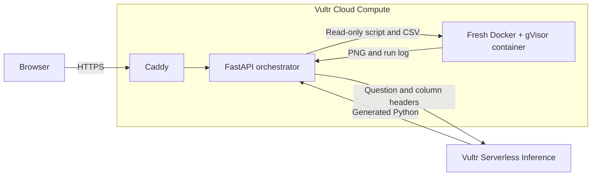

# CSV Analyst

Ask a question about a CSV and get a chart, the generated Python, and the run log. CSV Analyst is a Pattern A entry for the Stockholm Vultr Agent Runtime Hackathon.

**[Open the live demo](https://70.34.198.248)**

## Try it

1. Enter “Plot total revenue by month” and select **Use sample data**.
2. Open **Python code** and **Run log** under the chart.
3. Select **Test sandbox timeout**. The runner verifies the sandbox settings, starts a fixed infinite loop, stops it after three seconds, and removes the container.
4. Ask “Compare total revenue by product” to confirm a fresh analysis works after the timeout.

CSV uploads accept UTF-8 files with a header row up to 1 MiB. For local testing, a blank question runs the fixed monthly sales chart using the sample schema.

## Architecture



The inference key stays in the backend. The runner starts a fresh non-root container per job with networking disabled, a read-only root filesystem, bounded temporary storage, and no Docker socket. Chart jobs have a 20-second wall-clock limit, 256 MiB memory cap, one CPU, and a 32-process limit. The runner removes each container when the job finishes or times out. The public deployment uses gVisor and a prebuilt image.

## Local setup

Requires Python 3 with venv, Bash, and a running Docker daemon accessible to the account running the app.

```bash
python3 -m venv .venv
.venv/bin/pip install -r requirements.txt
install -m 600 .env.example .env
```

Set `VULTR_INFERENCE_API_KEY` and `VULTR_INFERENCE_MODEL` in `.env` to enable free-form questions. `VULTR_API_KEY` is optional and used only for provisioning outside the app.

```bash
set -a
source ./.env
set +a
.venv/bin/python -m uvicorn web.app:app --host 127.0.0.1 --port 8000
```

Open [localhost:8000](http://127.0.0.1:8000). For Vultr installation instructions, see [the deployment guide](deploy/README.md).
